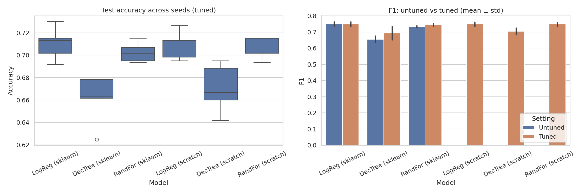
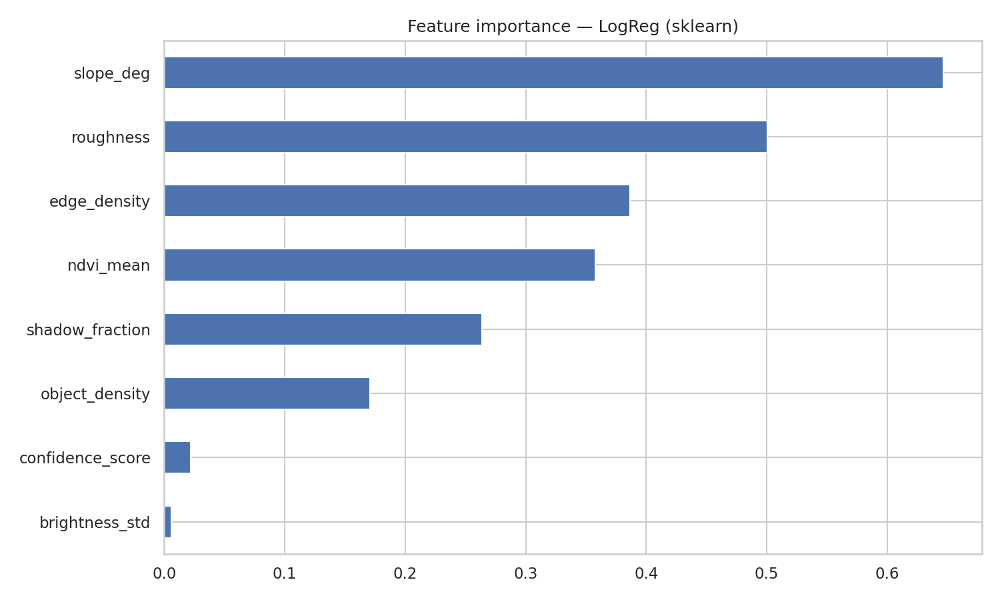
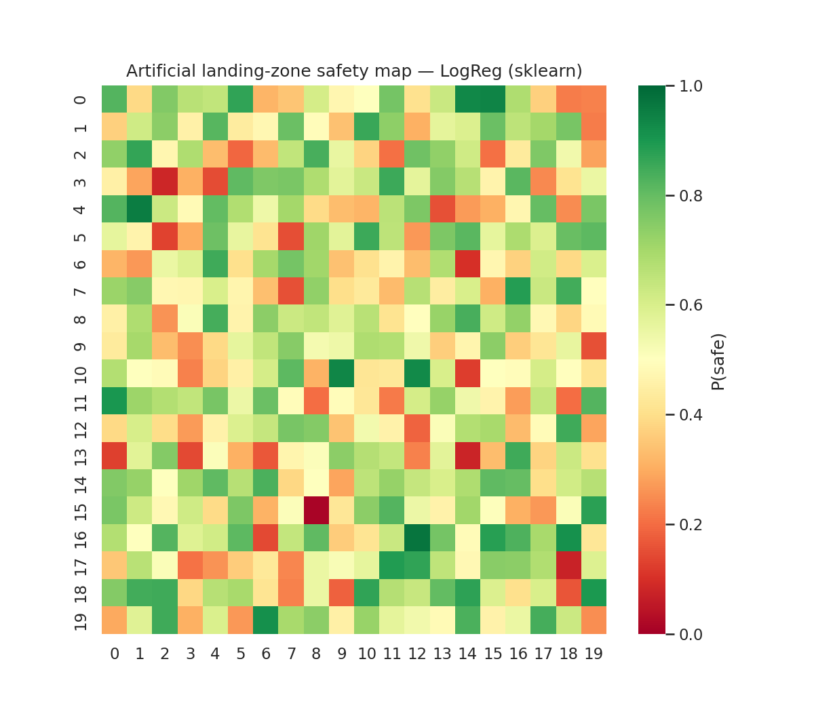

# Drone Landing Zone Safety Classification

Machine learning model that decides whether a patch of ground is safe for a drone to land on, then turns that decision into a landing action (land, land slowly, hover and re-scan, or abort).

This is my AI/ML capstone project. It compares Logistic Regression, Decision Tree and Random Forest, each in two versions: the scikit-learn one and one I wrote from scratch in NumPy. Every model is tuned and tested over 5 random seeds so the numbers aren't luck of one train/test split.



## The problem

Before an autonomous drone touches down it has to judge the ground below it. Steep slopes, rough surfaces, tall vegetation, shadows that hide obstacles and clutter on the ground all make a landing risky. The camera and onboard processing turn the scene into a handful of numbers, and the model has to say "safe" or "unsafe" from those numbers. A wrong "safe" can crash the drone, so the output is a probability that feeds a risk policy rather than a bare yes/no.

## Dataset

`data/Landing_Zone_Dataset.csv` has 3,000 rows: 8 terrain features extracted from drone imagery and a binary label (1 = safe, 0 = unsafe). The classes are close to balanced, with 1,650 safe and 1,350 unsafe.

| Feature | What it measures |
|---|---|
| `slope_deg` | Ground slope in degrees |
| `roughness` | Surface roughness |
| `edge_density` | Share of edge pixels, a proxy for clutter and debris |
| `ndvi_mean` | Average NDVI (how much vegetation there is) |
| `shadow_fraction` | Fraction of the patch in shadow |
| `brightness_std` | Variation in brightness |
| `object_density` | Density of detected objects |
| `confidence_score` | Confidence of the upstream perception step |

There are no raw images or GPS coordinates in the data, only the extracted features.

## Method

For each of the seeds 0, 1, 2, 42 and 123:

1. Stratified 80/20 train/test split.
2. `StandardScaler` fitted on the training data only, so nothing leaks from the test set.
3. Untuned scikit-learn baselines are trained and scored.
4. All six models are tuned on the training split with stratified cross-validation, scored by ROC-AUC. The scikit-learn models use `GridSearchCV`; the scratch models use a small grid search I wrote by hand that follows the same rules.
5. The tuned models are scored once on the held-out test set.

Results are reported as mean ± standard deviation over the 5 seeds.

The from-scratch models (NumPy only):

- `MyLogisticRegression`: batch gradient descent with an L2 penalty
- `MyDecisionTree`: CART with Gini impurity, using quantiles of each feature as candidate split points
- `MyRandomForest`: bagged `MyDecisionTree`s with random feature subsets at each split

## Results

Test-set scores, mean ± std over 5 seeds:

| Model | Setting | Accuracy | Precision | Recall | F1 | ROC-AUC |
|---|---|---|---|---|---|---|
| LogReg (sklearn) | Untuned | 0.713 ± 0.011 | 0.720 ± 0.012 | 0.783 ± 0.031 | 0.750 ± 0.013 | 0.782 ± 0.015 |
| LogReg (sklearn) | Tuned | 0.710 ± 0.015 | 0.716 ± 0.015 | 0.786 ± 0.029 | 0.749 ± 0.014 | 0.782 ± 0.015 |
| LogReg (scratch) | Tuned | 0.706 ± 0.013 | 0.708 ± 0.017 | 0.796 ± 0.033 | 0.749 ± 0.013 | 0.782 ± 0.015 |
| RandFor (sklearn) | Untuned | 0.693 ± 0.003 | 0.701 ± 0.010 | 0.769 ± 0.024 | 0.733 ± 0.007 | 0.753 ± 0.008 |
| RandFor (sklearn) | Tuned | 0.702 ± 0.009 | 0.706 ± 0.012 | 0.787 ± 0.023 | 0.744 ± 0.009 | 0.770 ± 0.013 |
| RandFor (scratch) | Tuned | 0.708 ± 0.010 | 0.710 ± 0.008 | 0.792 ± 0.026 | 0.749 ± 0.012 | 0.769 ± 0.013 |
| DecTree (sklearn) | Untuned | 0.621 ± 0.015 | 0.656 ± 0.011 | 0.655 ± 0.034 | 0.655 ± 0.020 | 0.617 ± 0.014 |
| DecTree (sklearn) | Tuned | 0.661 ± 0.022 | 0.690 ± 0.028 | 0.706 ± 0.096 | 0.694 ± 0.042 | 0.707 ± 0.025 |
| DecTree (scratch) | Tuned | 0.670 ± 0.022 | 0.695 ± 0.024 | 0.715 ± 0.036 | 0.704 ± 0.021 | 0.712 ± 0.021 |

What the numbers say:

- Logistic Regression comes out on top, with F1 around 0.75 and ROC-AUC around 0.78. The relationship between these features and safety is close to linear, so the simplest model is enough.
- Tuning helped the Decision Tree most: about +4 points of accuracy, because it stops the tree from overfitting. For Logistic Regression tuning made no real difference, and the change is smaller than the spread between seeds.
- My from-scratch models land within about a point of scikit-learn, which is a decent check that they are implemented correctly.
- Accuracy tops out near 71%. The features are noisy, so better models alone won't push this much higher; better features would.

Per-seed scores are in `results/v2/Seed_Results_All.csv` and the best hyperparameters for each seed in `results/v2/Best_Params_All_Seeds.csv`.

## From prediction to landing decision

The best model (Logistic Regression) gives a probability `P(safe)` for each zone. That probability maps to a risk tier and an action:

| P(safe) | Risk tier | Drone action | Test zones | Actually safe |
|---|---|---|---|---|
| ≥ 0.80 | Low | Land | 82 | 82% |
| 0.60 to 0.80 | Medium | Land with caution (slow descent, re-verify) | 180 | 76% |
| 0.40 to 0.60 | High | Hover and re-scan | 170 | 48% |
| < 0.40 | Critical | Abort and find another zone | 168 | 27% |

The share of truly safe zones drops steadily from tier to tier, so the probabilities carry real information and the policy is sensible. Even the "Low risk" tier is wrong about 1 time in 5, though. On a real drone you'd want a stricter threshold for a full landing, or a second check from another sensor.

The full table with predictions, tiers and actions for the 600 test zones is in `results/v2/Landing_Zone_Final_Output_v2.csv`.

### Feature importance



Slope and roughness matter most, followed by edge density and vegetation (NDVI). Brightness variation and the perception confidence score barely affect the decision.

### Safety heatmap



The dataset has no coordinates, so this map places 400 test zones on an artificial 20×20 grid and colours each cell by `P(safe)`. It shows how a real map would look once location data is available; the layout itself means nothing.

## Repository structure

```
.
├── notebooks/
│   ├── landing_zone_safety_v2.ipynb   # main notebook: tuning, scratch models, 5 seeds
│   └── landing_zone_safety_v1.ipynb   # first version: single split, sklearn only
├── data/
│   └── Landing_Zone_Dataset.csv       # 3,000 rows, 8 features + label
├── results/
│   ├── v2/                            # multi-seed results, best params, final output
│   └── v1/                            # results from the first version
├── figures/                           # plots used in this README
└── requirements.txt
```

## How to run

Easiest is Google Colab: open `notebooks/landing_zone_safety_v2.ipynb` and run all cells. The notebook reads the dataset from a Google Sheet link, so it works without any setup.

To run locally:

```bash
git clone https://github.com/anuraggautam25/drone-landing-zone-safety.git
cd drone-landing-zone-safety
pip install -r requirements.txt
jupyter notebook notebooks/landing_zone_safety_v2.ipynb
```

If you're offline, change the `URL` in the "Load data" cell to `../data/Landing_Zone_Dataset.csv`. There's a `FAST` flag near the top that shrinks the Random Forest grids if you want a quicker run.

## Limitations and next steps

- The features are already extracted. A full system would compute them from drone images, or skip them and train a CNN on the images directly.
- There's no spatial information, so neighbouring zones can't inform each other and the heatmap is only illustrative.
- 3,000 samples is small. More data, and a calibration step for the probabilities, would make the risk tiers more trustworthy.
- In this setting a false "safe" costs far more than a false "unsafe". Picking thresholds by cost instead of fixed probability cut-offs would fit the problem better.

## Author

Anurag Gautam, M.Tech Cyber Security, Delhi Technological University
